# SuperDrag

<p align="center">
  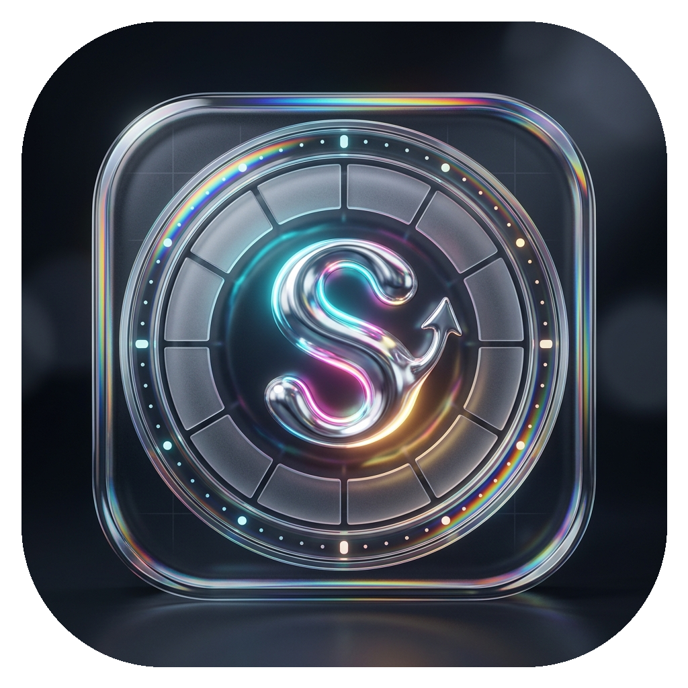<br>
  <b>Fluid 3D Liquid-Glass Drag-and-Drop Conversion & Productivity Utility</b><br>
  <i>Created by <b>Manish</b></i>
</p>

<p align="center">
  <a href="https://github.com/officialgodgoku/SuperDrag/releases/latest"></a>
  <a href="LICENSE"></a>
  <a href="https://www.python.org"></a>
  <a href="https://buymeacoffee.com/officialgodgoku"></a>
</p>

---

SuperDrag lets you convert, compress, edit, and organize files on **Windows, macOS, and Linux** using an intuitive, real-time liquid-glass radial dial. Start dragging any file, press **Shift** (or **Ctrl** / **Alt**), and drop it onto a slice. 

Original files are **never overwritten or altered** — outputs are always cleanly generated next to the source.

---

## 🌟 Visual Showcase

Convert, compress, and edit with real-time chromatic dispersion and adaptive frosted glass:

<p align="center">
  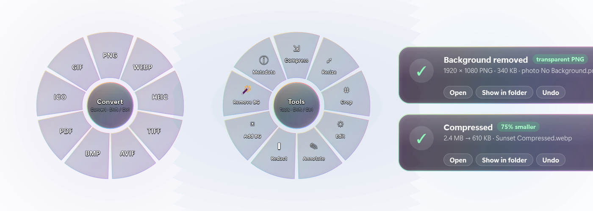
</p>

### 🎛️ SuperDrag Hub (Desktop Drop Zone & Launcher)
Double-click the tray icon or drop files onto the desktop Hub to quickly access dials, browse files, and configure shortcuts:

<p align="center">
  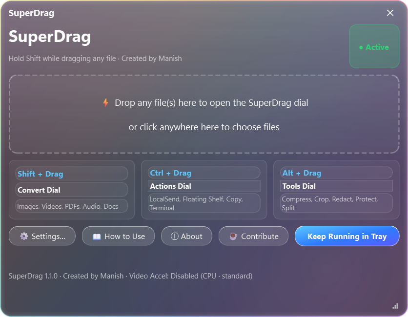
</p>

---

## 📂 Radial Dials by File Category

SuperDrag dynamically customizes its radial petal slices depending on what you are dragging:

| **Images (Convert & Tools)** | **Videos (Convert & Media Tools)** |
|:---:|:---:|
| 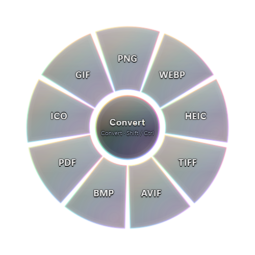<br><i>Image Formats (PNG, JPG, WEBP, HEIC, AVIF, TIFF, BMP, ICO)</i> | 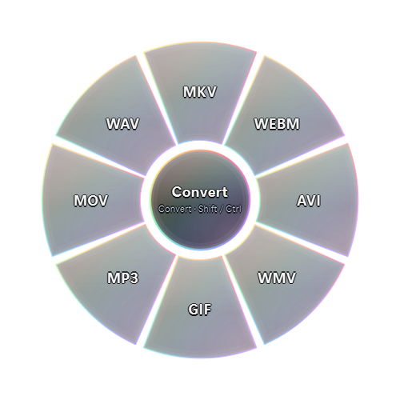<br><i>Video Formats (MP4, WEBM, MOV, MKV, MP3 extract)</i> |
| **Image Tools Ring (Includes AI Remove BG)** | **Audio Tools & Encoders** |
| 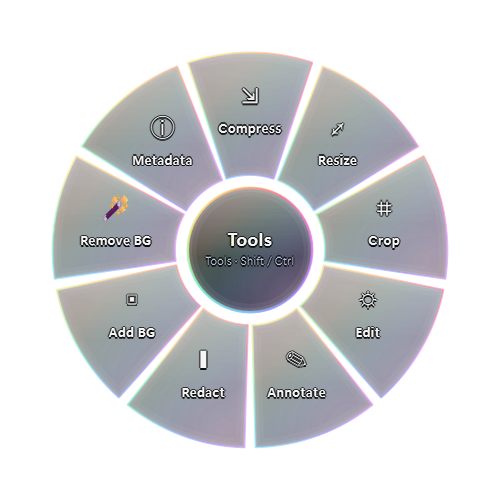<br><i>Compress, Resize, Crop, Edit, Annotate, Redact, Add BG, <b>Remove BG</b></i> | 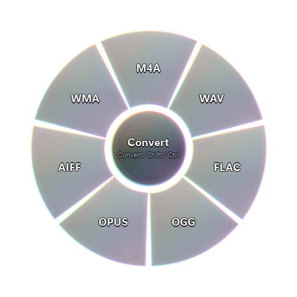<br><i>MP3, WAV, FLAC, Waveform Visualizer, Normalize, Bleep tone</i> |
| **PDF Tools & Document Converter** | **Archive Compressions & Extraction** |
| <br><i>DOCX, JPG, PNG, TXT, Compress, Split, Rotate, Merge, Protect</i> | 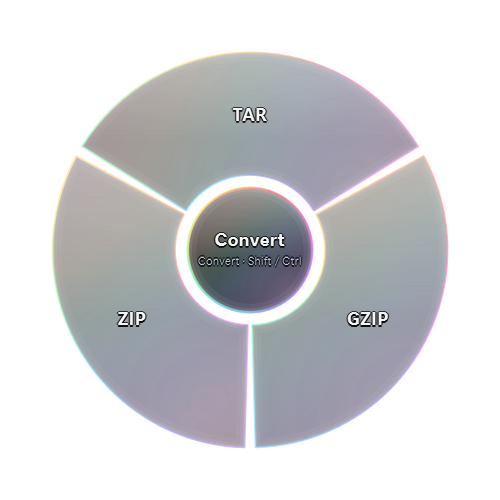<br><i>ZIP (Deflate/Max/Store/BZIP2/LZMA), TAR.GZ, TAR, Extract</i> |

### ⚡ File Actions Dial (`Ctrl + Drag`)
Perform instant desktop operations on any file or folder:
<p align="center">
  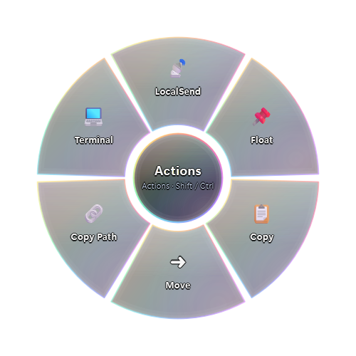<br>
  <i>LocalSend sharing · Pin to Floating Shelf · Copy · Move · Copy Path · Open Terminal</i>
</p>

---

## 🛠️ Functional Utility Tools

SuperDrag features dedicated liquid-glass editor windows for precise controls:

| **AI Background Removal ("Remove BG")** | **Smart Image & PDF Compression** |
|:---:|:---:|
| 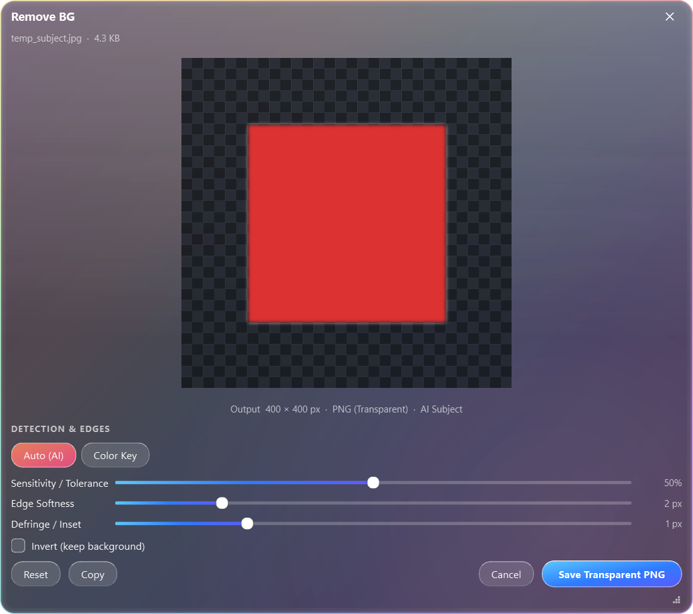<br><i>ONNX neural subject cutout · Color Keying · Transparency checkerboard</i> | 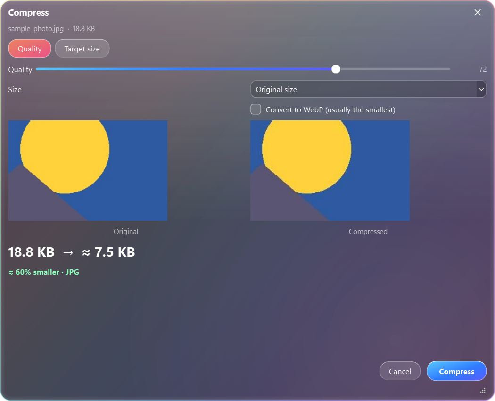<br><i>Visual before/after quality comparison · Live file size savings</i> |
| **Canvas & Backdrop Studio ("Add BG")** | **Interactive Crop & Rotation ("Crop")** |
| 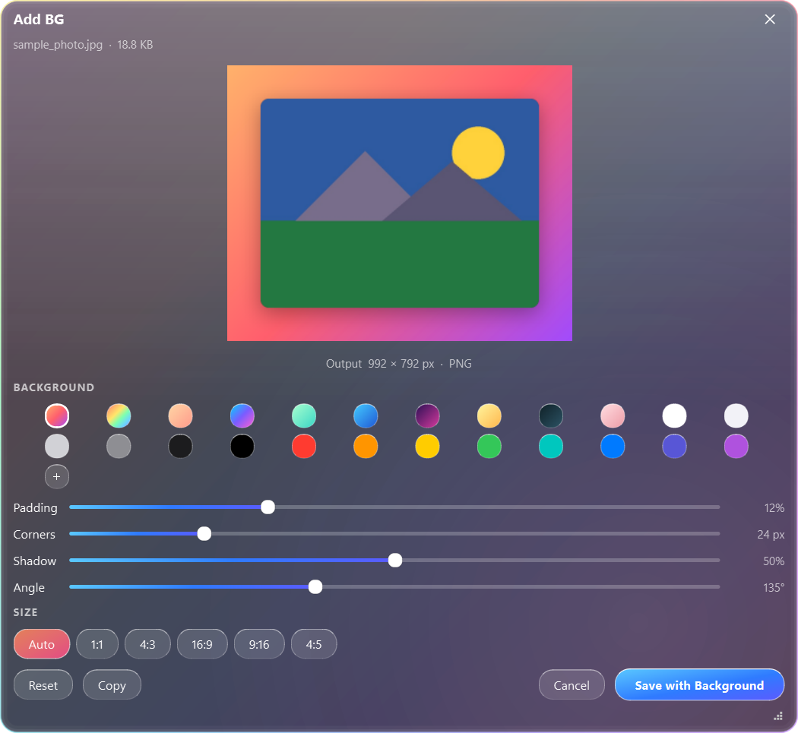<br><i>CSS-style gradient backdrops · Soft drop shadows · Aspect ratio framing</i> | 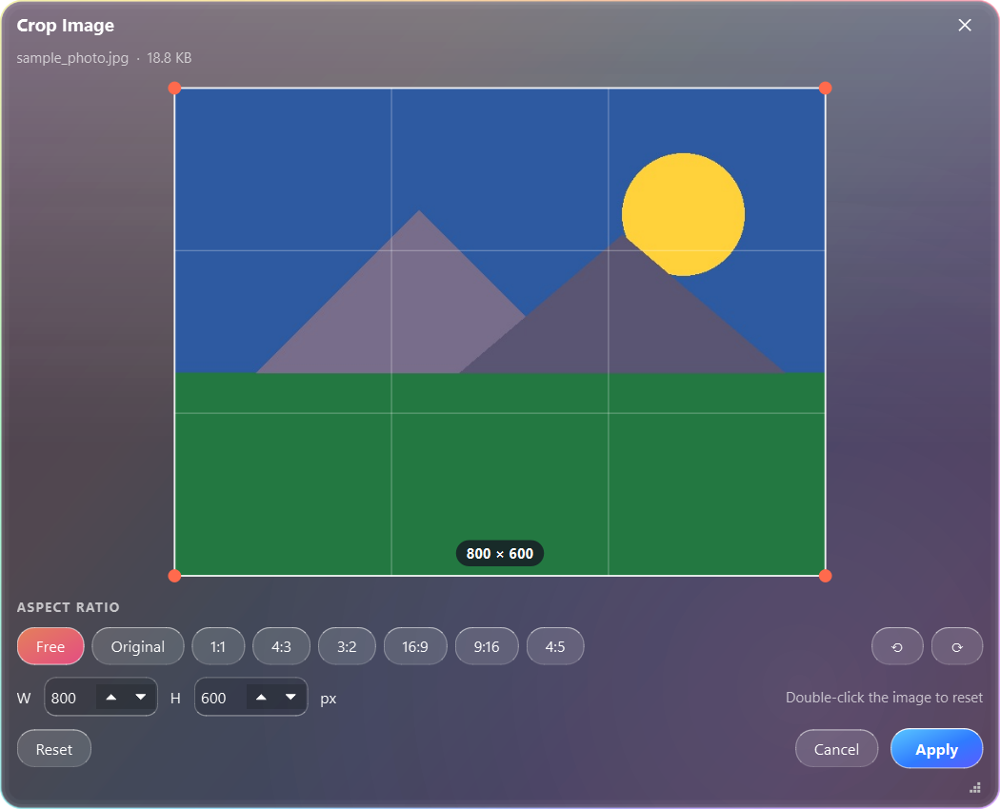<br><i>Aspect ratio presets (1:1, 4:3, 16:9, freeform) · 90° rotation</i> |
| **GPU Hardware Acceleration & Settings** | **About SuperDrag & Community Sponsorship** |
| 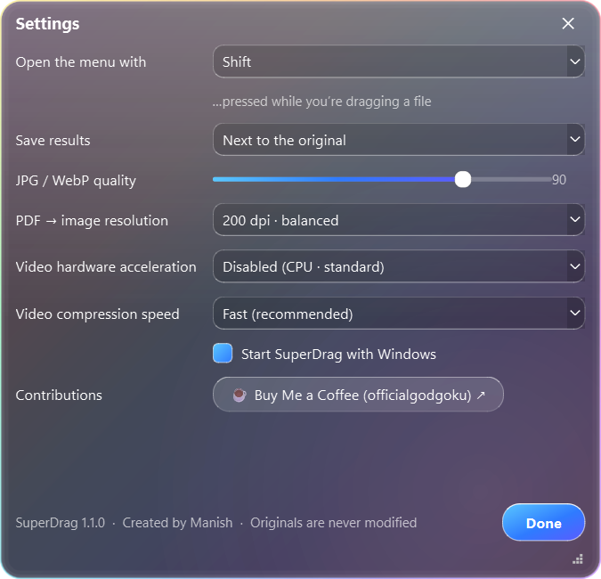<br><i>Hardware acceleration (NVIDIA NVENC, Intel QSV, AMD AMF)</i> | 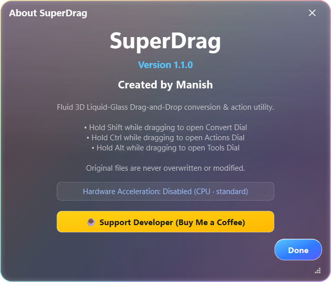<br><i>Version info</i> |

---

## 🚀 Key Features

- **Liquid-Glass Radial Dial**:
  - **Convert Ring (`Shift + Drag`)**: Universal conversion across 40+ file formats (Images, Video, Audio, PDF, Office documents, Archives).
  - **Actions Ring (`Ctrl + Drag`)**: LocalSend sharing, Floating Desktop Shelf, Clipboard Copy, Terminal Open, Path Copy.
  - **Tools Ring (`Alt + Drag`)**: Compress, Resize, Crop, Edit, Annotate, Redact, Add BG, and Remove BG.
  - Multi-file center dwell ring switching with smooth 900–1200ms debounce.
- **AI Background Removal**:
  - Deep-learning salient object detection (`u2netp` ONNX model bundled offline).
  - High-performance Color Key & Chroma Matting with custom click-to-pick eyedropper.
  - Real-time Sensitivity, Edge Softness (Gaussian feathering), and Defringing/Erosion controls.
  - One-click copy transparent PNG to clipboard or save to disk.
- **Hardware-Accelerated Video Processing**:
  - Optional GPU encoding with NVIDIA NVENC (`h264_nvenc`, `hevc_nvenc`), Intel QuickSync (`h264_qsv`), AMD AMF (`h264_amf`), and Apple VideoToolbox (`h264_videotoolbox`).
  - Video presets configurable from `veryfast` down to `slower` for precise speed vs file-size balance.
- **Audio & Media Suite**:
  - Peak volume normalization, waveform visualizer generation, audio bleep tone censorship, mono/stereo conversion.
- **PDF & Document Tools**:
  - Lossless and lossy PDF compression, AES-256 encryption, page rotation, splitting, and multi-file PDF merging.
- **Universal Archive Management**:
  - Extract archives with one click; compress folders into standard ZIP, TAR, TAR.GZ, BZIP2, or LZMA ultra.

---

## 📥 Download & Install

From the [**Latest Releases**](https://github.com/officialgodgoku/SuperDrag/releases/latest):

### Windows (Recommended)
- **`SuperDrag-Setup.exe`**: Per-user silent or wizard installation (no administrator privileges required). Adds Start Menu shortcut, autostart option, and Explorer integration.
- **`SuperDrag.exe`**: Portable standalone executable. Run anywhere without installing.

### macOS (macOS 11+)
- **`SuperDrag-mac-apple-silicon.dmg`**: For M1, M2, M3, M4 Macs.
- **`SuperDrag-mac-intel.dmg`**: For Intel Macs.
- Or install via Terminal:
  ```bash
  curl -fsSL https://raw.githubusercontent.com/officialgodgoku/SuperDrag/main/install-mac.sh | bash
  ```

### Linux (Debian, Ubuntu, Mint, XFCE/KDE/GNOME)
- Download `SuperDrag-linux-amd64.deb` and install:
  ```bash
  sudo apt install ./SuperDrag-linux-amd64.deb
  ```

---

## 🔍 Supported Tools & Capabilities Index

SuperDrag is built as an all-in-one offline desktop productivity powerhouse. Below is an index of all supported tools, formats, and capabilities:

| Category | Available Tools & Features | Supported File Types & Search Keywords |
|---|---|---|
| **🪄 AI Background Removal** | Neural salient subject cutout, Color Keying / Chroma matting, eyedropper color picker, sensitivity slider, edge softness (Gaussian feather), defringing / erosion, real-time transparency checkerboard preview | `remove-bg`, `transparent background`, `cutout image`, `png transparent`, `chroma key`, `green screen remover`, `ai background remover`, `offline background removal` |
| **🖼️ Image Conversion** | 1-click batch and single-file conversions with color space preservation, multi-frame support, icon creation | `PNG`, `JPG / JPEG`, `WEBP`, `HEIC / HEIF`, `AVIF`, `TIFF`, `BMP`, `ICO (Favicon maker)`, `heic to png`, `heic to jpg`, `webp converter` |
| **✂️ Image Editing & Tools** | Smart compression with visual diff & live size reduction, aspect ratio crop (`1:1`, `4:3`, `16:9`, freeform), 90° rotation, gradient backdrops ("Add BG"), soft drop shadows, image annotations, sensitive data redaction & blur, EXIF metadata scrubber | `compress image`, `reduce file size`, `crop tool`, `image backdrop`, `gradient background`, `redact image`, `blur info`, `clean metadata`, `image optimizer` |
| **📄 PDF & Document Suite** | Lossless & lossy PDF compression, multi-file PDF merge, PDF page splitting, 90° page rotation, AES-256 PDF encryption & password protection, PDF to image page export, Word to PDF, Sheets conversion | `PDF compressor`, `merge pdf`, `split pdf`, `rotate pdf`, `password protect pdf`, `docx to pdf`, `pdf to docx`, `pdf to png`, `csv to xlsx`, `excel to csv`, `markdown to pdf` |
| **🎬 Video Processing** | GPU hardware-accelerated video encoding (NVIDIA NVENC, Intel QuickSync QSV, AMD AMF, Apple VideoToolbox), preset rate control (`ultrafast` to `veryslow`), audio track extraction, video container transcode | `MP4`, `WEBM`, `MOV`, `MKV`, `extract mp3 from video`, `video compressor`, `hardware accelerated converter`, `nvenc encoder`, `offline video converter` |
| **🎵 Audio Utilities** | Peak volume normalization, waveform visualizer PNG generator, audio censor bleep tone synthesizer, mono/stereo downmixing, bitrate control | `MP3`, `WAV`, `FLAC`, `M4A`, `audio normalizer`, `waveform generator`, `bleep audio`, `audio converter` |
| **📦 Archive Utilities** | Fast extraction, archive creation with configurable compression algorithms (Deflate, BZIP2, LZMA ultra, Store) | `ZIP`, `TAR`, `TAR.GZ`, `extract archive`, `zip compressor`, `tar creator` |
| **⚡ Desktop Productivity** | Fluid liquid-glass radial dial, LocalSend / AirDrop sharing, persistent floating shelf drop zone, copy path, terminal launcher, SuperDrag Hub | `radial menu`, `pie menu`, `drag and drop utility`, `localsend`, `floating shelf`, `offline cloudconvert alternative` |

---

## ⌨ Shortcuts & Usage

| Trigger | Dial / Action | Capabilities |
|---|---|---|
| **`Shift + Drag`** | **Convert Dial** | Image formats (PNG, JPG, WEBP, HEIC, AVIF, TIFF, BMP, ICO), Video formats (MP4, WEBM, MOV, MKV), Audio (MP3, WAV, FLAC, M4A), Docs (DOCX, PDF, TXT) |
| **`Ctrl + Drag`** | **Actions Dial** | Send via LocalSend, Pin to Floating Shelf, Copy to Clipboard, Reveal Path, Open Terminal |
| **`Alt + Drag`** | **Tools Dial** | Compress, Resize, Crop, Annotate, Redact, Add BG, Remove BG, Metadata Cleaner |
| **Double-Click Tray** | **SuperDrag Hub** | Quick desktop drag-and-drop workspace and preferences |

---

## ☕ Support & Contribute

SuperDrag is free and open-source software created by **Manish**.

If SuperDrag saves you time or boosts your workflow, consider supporting development:

<p align="center">
  <a href="https://buymeacoffee.com/officialgodgoku">
    
  </a>
</p>

You can also contribute code, report bugs, or propose new features:
- Read our [**Contributing Guide**](CONTRIBUTING.md)
- Submit a [Bug Report](.github/ISSUE_TEMPLATE/bug_report.md) or [Feature Request](.github/ISSUE_TEMPLATE/feature_request.md)

---

## 🛠 Run from Source

```bash
# Clone the repository
git clone https://github.com/officialgodgoku/SuperDrag.git
cd SuperDrag

# Install dependencies
pip install -r requirements.txt

# Run SuperDrag
python run.py
```

Run test suite:
```bash
python -m pytest tests/
```

---

## 👤 Author

Created by **Manish** ([@officialgodgoku](https://github.com/officialgodgoku))

## 📄 License

Licensed under the [MIT License](LICENSE). Free to use, modify, and distribute.

